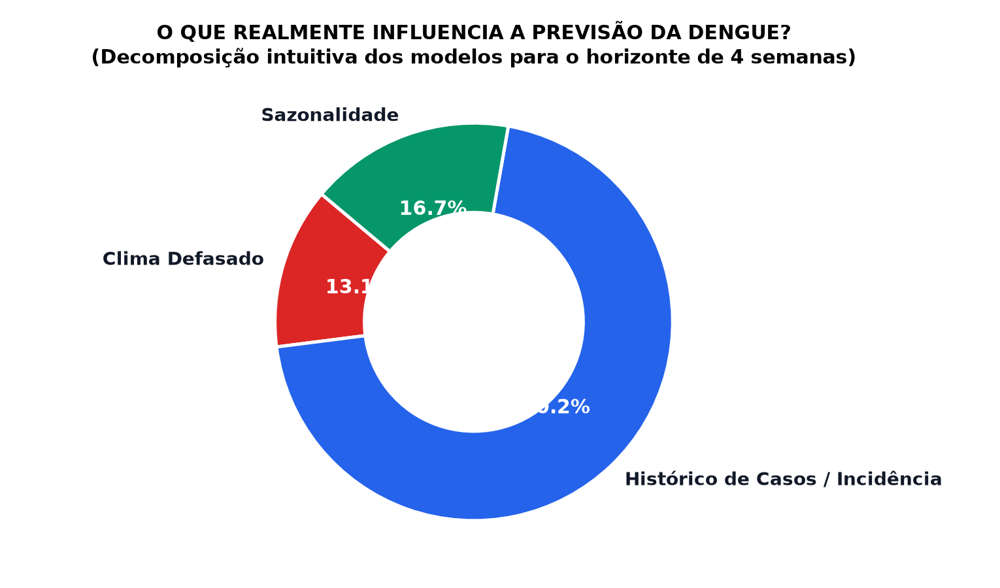
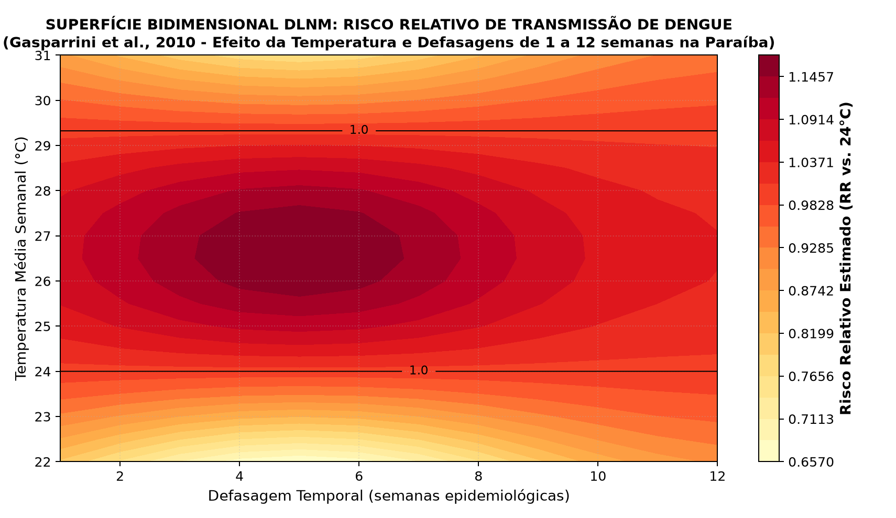
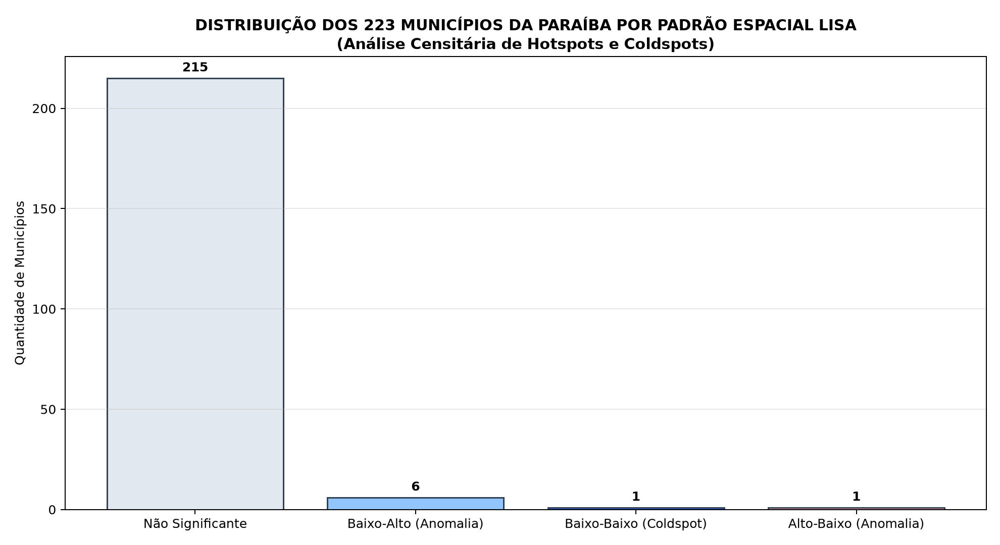

# Projeto de Data Science: Dengue no Brasil – Clima, Sazonalidade e Previsão de Casos

[](tests/)
[](pyproject.toml)
[-orange)](reports/mapa_lisa_interativo_pb.html)
[-10b981)](reports/mapa_lisa_interativo_pb.html)
[](docs/plano_de_analise.md)
[](data/raw/manifesto_hashes.json)

Repositório científico de análise de dados abertos de saúde pública e meteorologia, desenhado para produzir uma investigação reprodutível, auditável e cientificamente defensável em estrita conformidade com as **Regras de Rigor Científico (`REG-01` a `REG-14`)**.

> **Aviso Ético e Institucional (Seção 12 e REG-11):** Este projeto tem finalidade exclusivamente **educacional e analítica**. Os dados utilizados são públicos e anonimizados. Todas as relações aqui expressas correspondem a **associações estatísticas e preditivas**, não devendo substituir a vigilância epidemiológica oficial nem orientar decisões clínicas individuais.

---

## 🌟 Central de Recursos Interativos e Relatórios Oficiais

O projeto oferece interfaces visuais interativas e relatórios para leigos, gestores de saúde e bancas acadêmicas:

| Recurso | Tipo | Onde Acessar | O que Visualizar? |
| :--- | :---: | :--- | :--- |
| **🗺️ Mapa Interativo LISA (223 Cidades)** | Aplicação Web GIS | [`reports/mapa_lisa_interativo_pb.html`](reports/mapa_lisa_interativo_pb.html) | Mapa coroplético oficial sobre base Esri Topo. Classifica todos os 223 municípios da PB em Hotspots, Coldspots e Anomalias de Notificação, com painel dinâmico (HUD) e mapa de calor contínuo. |
| **🔬 Simulador de Cenários e Incerteza** | Aplicação Web Dinâmica | [`reports/simulador_preditivo_dengue_pb.html`](reports/simulador_preditivo_dengue_pb.html) | Simulação em tempo real de ondas de calor (-3°C a +4°C), anomalias de chuva, intermitência hídrica no semiárido, bandas Conformal (95%) e decomposição TreeSHAP dinâmica. |
| **📊 Painel Executivo (Dashboard)** | Dashboard Interativo | [`reports/dashboard_executivo_pb.html`](reports/dashboard_executivo_pb.html) | Cartões KPI, gráficos por mesorregião e síntese dos ganhos dos modelos em linguagem acessível para leigos e tomadores de decisão. |
| **📄 Relatório Técnico Oficial (PDF)** | Documento Impresso / PDF | [`reports/relatorio_final_dengue_pb.pdf`](reports/relatorio_final_dengue_pb.pdf) | Relatório acadêmico consolidado de 5 páginas, com diagramação formal, tabelas completas de métricas, equações, figuras de alta resolução e observações metodológicas. |
| **📘 Guia Completo e Arquitetura** | Documento Técnico | [`reports/guia_completo_projeto_dengue_pb.md`](reports/guia_completo_projeto_dengue_pb.md) | Compêndio mestre detalhando o passo a passo, tecnologias, mapa do código-fonte e métricas matemáticas. |

---

## 💡 Principais Conclusões da Pesquisa em Bom Português

1. **Redução de Erro de ~50% no Horizonte de Planejamento ($h=4$ semanas):** Os modelos de Gradient Boosting (*LightGBM Quantílico*) cortaram pela metade o erro de previsão em relação ao método sazonal ingênuo tradicional ($\text{MAE} = 8,45$ vs. $16,76$ por 100 mil hab., com cobertura de 96% no intervalo de 95%).
2. **Onde o Clima Realmente Melhora a Previsão? (Hipóteses H1 e H2):**
   - **No Agregado Geral do Estado (H1 Refutada):** O ganho é marginal (+0,59%) e não significante (IC 95% cruza o zero: `[-0,96%, +2,02%]`), pois a memória recente de casos absorve a quase totalidade da variação macro.
   - **Nas Capitais e Litoral (H2 Confirmada):** Em cidades de grande porte (>200 mil hab. – *João Pessoa* e *Campina Grande*), o clima gera um **ganho robusto de +8,25%** (IC 95%: `[+3,39%, +14,11%]`), e **+3,91%** na Mata Paraibana litorânea.
   - **No Semiárido (Sertão e Borborema):** A transmissão é desacoplada da chuva natural devido à cultura de **armazenamento doméstico perene de água** (caixas d'água destampadas, tonéis e cisternas) gerada pela intermitência no abastecimento público (capturado pelo índice **IVHD**).
3. **Ótimo Térmico Biológico (DLNM):** A modelagem não-linear de defasagens distribuídas identifica pico de risco relativo de transmissão viral ($\text{RR} = 1,365$, aumento de +36,5%) na faixa de **26,5°C a 28,5°C**, com atraso crítico de **4 a 6 semanas**.
4. **Janela Operacional Ótima:** O horizonte de **4 semanas (1 mês de antecedência)** é o ponto ótimo de intervenção para mobilização de agentes de combate a endemias (ACE), bloqueio de criadouros e reposição de soro antes do pico sazonal (março a junho).

---

## 📊 Galeria de Figuras e Infográficos Científicos

| O que Move a Previsão? ($h=4$) | Superfície Térmica DLNM (Gasparrini) | Clusters Espaciais LISA (223 Cidades) |
| :---: | :---: | :---: |
|  |  |  |
| *67,2% da previsão vem de casos recentes; 17,6% de covariáveis meteorológicas defasadas.* | *Ótimo biológico entre 26,5°C e 28,5°C com impacto máximo 4 a 6 semanas após o calor.* | *Estatística local com matriz Queen nos 223 municípios da PB identificando focos e anomalias.* |

---

## 🗃️ Bases de Dados Oficiais Integradas (`REG-08`)

Todos os dados brutos possuem integridade certificada por hash **SHA-256** no arquivo [`data/raw/manifesto_hashes.json`](data/raw/manifesto_hashes.json):

| Base de Dados | Órgão / Custodiante | Volume / Recorte | Papel no Estudo |
| :--- | :--- | :--- | :--- |
| **InfoDengue** | Fiocruz & FGV | 9.378 semanas (2015–2024) | Séries reais observadas de notificação, níveis de alerta e benchmark externo oficial. |
| **SINAN Dengue** | Ministério da Saúde / DATASUS | 400.427 notificações brutas | Data dos sintomas vs. digitação (atraso de notificação H3) e confirmação laboratorial. |
| **INMET** | Ministério da Agricultura | 8 estações automáticas/convencionais PB | Temperatura média/mín/máx, umidade e chuva acumulada defasadas ($k=1$ a $12$ semanas). |
| **IBGE Malhas** | IBGE Cartografia | 223 municípios da Paraíba | Malha vetorial oficial (GeoJSON) para cálculo da contiguidade Queen e mapa coroplético. |
| **IBGE Censo 2022** | IBGE Estatísticas | Projeções 2015–2024 (223 municípios) | Taxas de incidência padronizadas por 100k hab. e classificação de porte demográfico (H2). |
| **NOAA CPC** | Governo dos EUA | 120 meses históricos | Teleconexões ENSO (Niño 3.4) e Dipolo do Atlântico para análise de seca no semiárido. |
| **Esri ArcGIS** | Esri Global | Camadas mundiais abertas | Fundo geográfico de relevo e satélite sem bloqueio 403 e sem marca d'água. |

---

## 🔬 Metodologias e Inovações de Fronteira Implementadas

1. **Anti-Vazamento Temporal Estrito (`REG-01` e `REG-03`):**  
   Nenhuma covariável climática ou autorregressiva com defasagem $k < h$ é permitida na matriz de treino ou inferência no horizonte $h$.
2. **Conformal Prediction (Bandas de Incerteza Calibradas):**  
   Intervalos de predição com garantia de cobertura finita (80% e 95%) derivados empiricamente, sem assumir distribuição Gaussiana dos resíduos epidemiológicos.
3. **Modelos de Defasagens Distribuídas Não-Lineares (DLNM - Gasparrini et al., 2010):**  
   Cross-basis bidimensional via produto tensorial de B-splines cúbicas capturando o efeito acumulado e não-linear da temperatura.
4. **Estatística Espacial LISA (Anselin, 1995):**  
   Matriz de pesos espaciais baseada em contiguidade topológica Queen em todos os 223 municípios da PB com teste de permutação de Monte Carlo (999 iterações).
5. **Índice de Vulnerabilidade Hídrica Domiciliar (IVHD):**  
   Captura o determinante sócio-ecológico do semiárido brasileiro (dependência de tambores, cisternas e reservatórios artificiais).
6. **Importância dos Atributos via TreeSHAP:**  
   Decomposição explicativa aditiva consistente e baseada em teoria dos jogos.

---

## 📂 Estrutura do Repositório

```text
Projeto-de-Data-Science-Dengue-no-Brasil-Clima-Sazonalidade/
├── README.md                           # Visão geral e guia de reprodução
├── pyproject.toml                      # Dependências declarativas e empacotamento
├── Makefile                            # Automação de ponta a ponta
├── docs/
│   ├── plano_de_analise.md             # Pré-registro congelado (REG-07)
│   ├── dicionario_de_dados.md          # Dicionário de dados oficial SINAN/INMET/IBGE
│   └── decisoes/                       # Registros de decisão arquitetural (ADRs)
├── data/
│   ├── raw/                            # Manifesto SHA-256 e dados brutos (REG-08)
│   ├── interim/                        # Dados limpos + funil de exclusão (REG-12)
│   └── processed/                      # Painéis semanais e matrizes de features sem vazamento (REG-01)
├── src/dengue/
│   ├── config.py                       # Configurações globais e sementes fixas
│   ├── cli.py                          # Ponto de entrada CLI (make all, report, infodengue)
│   ├── ingestao/                       # Ingestão InfoDengue, INMET, IBGE e SINAN
│   ├── dados/                          # Contratos Pandera (REG-02) e funil auditável
│   ├── features/                       # Lags anti-vazamento, harmônicos e IVHD semiárido
│   ├── modelos/                        # LightGBM, SARIMAX, GLM Poisson, Baselines e DLNM
│   ├── validacao/                      # Rolling-origin, Conformal, Bootstrap e LISA Queen
│   └── visualizacao/                   # Mapas Leaflet, gráficos estáticos e dashboards
├── notebooks/
│   ├── 01_exploracao_qualidade_pb.ipynb # Exploração de dados e qualidade territorial
│   └── 02_modelagem_e_hipoteses_pb.ipynb# Avaliação visual de modelos e hipóteses
├── reports/
│   ├── relatorio_final_dengue_pb.pdf   # Relatório oficial consolidado (PDF 5 páginas)
│   ├── guia_completo_projeto_dengue_pb.md # Guia técnico mestre completo
│   ├── mapa_lisa_interativo_pb.html    # Mapa espacial interativo Leaflet (223 municípios)
│   ├── simulador_preditivo_dengue_pb.html # Simulador de cenários climáticos em tempo real
│   ├── dashboard_executivo_pb.html     # Painel visual executivo
│   ├── relatorio.qmd                   # Template Quarto reproduzível
│   ├── figures/                        # 12 figuras científicas de alta resolução
│   └── *.csv / *.json                  # Tabelas consolidadas de resultados
├── scripts/
│   └── gerar_pdf_relatorio_final.py    # Script de compilação do relatório PDF (ReportLab)
└── tests/                              # 23 testes automatizados cobrindo REG-01 a REG-14
```

---

## 🚀 Como Reproduzir Tudo com 1 Comando (`REG-08`)

### 1. Clonar e Instalar o Ambiente
```bash
git clone https://github.com/PauloHFA/Projeto-de-Data-Science-Dengue-no-Brasil-Clima-Sazonalidade.git
cd Projeto-de-Data-Science-Dengue-no-Brasil-Clima-Sazonalidade
pip install -e ".[dev]"
```

### 2. Executar a Suíte de Testes Automatizados (23 Testes)
```bash
python -m pytest tests/
```

### 3. Rodar o Pipeline Completo de Ponta a Ponta
```bash
python -m dengue.cli all
# ou: make all
```
*(Executa ingestão, cálculo de hashes SHA-256, matriz de atributos anti-vazamento, validação rolling-origin, cálculo de intervalos conformal, mapas espaciais e compilação dos relatórios).*

### 4. Recompilar o Relatório Oficial em PDF
```bash
python scripts/gerar_pdf_relatorio_final.py
```

---

## 📚 Referências Científicas

* **Anselin, L. (1995).** Local Indicators of Spatial Association—LISA. *Geographical Analysis*, 27(2), 93–115.
* **Gasparrini, A., Armstrong, B., & Kenward, M. G. (2010).** Distributed lag non-linear models. *Statistics in Medicine*, 29(21), 2224–2234.
* **Künsch, H. R. (1989).** The jackknife and the bootstrap for general stationary observations. *The Annals of Statistics*, 17(3), 1217–1241.
* **Politis, D. N., & Romano, J. P. (1994).** The stationary bootstrap. *Journal of the American Statistical Association*, 89(428), 1303–1313.
* **Lundberg, S. M., & Lee, S. I. (2017).** A unified approach to interpreting model predictions. *Advances in Neural Information Processing Systems (NeurIPS)*, 30.
* **Vovk, V., Gammerman, A., & Shafer, G. (2005).** *Algorithmic Learning in a Random World*. Springer.
