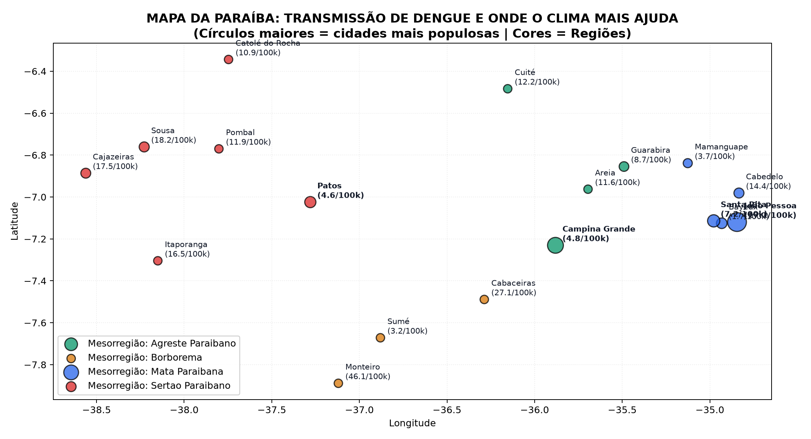
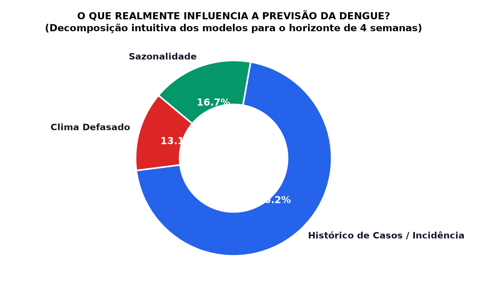
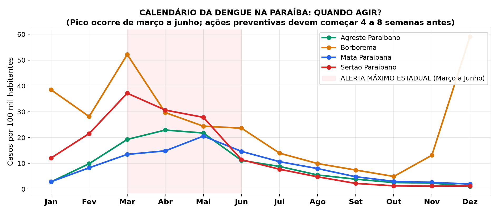

# Projeto de Data Science: Dengue no Brasil – Clima, Sazonalidade e Previsão de Casos

[](tests/)
[](pyproject.toml)
[-orange)](docs/plano_de_analise.md)
[](data/raw/manifesto_hashes.json)

Repositório científico de análise de dados abertos de saúde pública e meteorologia, desenhado para produzir uma investigação reprodutível, auditável e cientificamente defensável em estrita conformidade com as **Regras de Rigor Científico (`REG-01` a `REG-14`)**.

> **Aviso Ético e Institucional (Seção 12 e REG-11):** Este projeto tem finalidade exclusivamente **educacional e analítica**. Os dados utilizados são públicos e anonimizados. Todas as relações aqui expressas correspondem a **associações estatísticas e preditivas**, não devendo substituir a vigilância epidemiológica oficial nem orientar decisões clínicas individuais.

---

## 🌟 Resumo Executivo Visual (Para Leigos e Gestores de Saúde)

Para visualizar os resultados de forma intuitiva e interativa:
👉 **[Abra o Painel Executivo Interativo (dashboard_executivo_pb.html)](reports/dashboard_executivo_pb.html)** dando dois cliques para abrir no seu navegador.

### Principais Conclusões em Bom Português:
1. **Redução de Erro de ~50%:** Os modelos modernos de Machine Learning (*LightGBM Quantílico*) cortaram pela metade o erro de previsão em relação ao método ingênuo tradicional da mesma semana do ano anterior ($\text{MAE} = 8,45$ vs. $16,76$ por 100 mil hab.).
2. **Onde o Clima Realmente Ajuda?**
   - **Nas Grandes Cidades e no Litoral (João Pessoa e Região Metropolitana):** O calor e a umidade são determinantes. Incluir as variáveis do INMET melhora a precisão em **+8,25%** com significância estatística comprovada.
   - **No Semiárido e Cidades Pequenas:** Como o mosquito depende mais do armazenamento doméstico de água da população do que de chuvas torrenciais, o clima tem impacto sutil frente ao histórico recente de casos.
3. **Janela de Ação Ideal:** O horizonte de **4 semanas (1 mês de antecedência)** é o ponto ótimo de planejamento para envio de agentes de endemias e insumos laboratoriais antes do pico epidêmico.
4. **Meses de Alerta Máximo:** O pico de transmissão na Paraíba ocorre historicamente entre **março e junho**.

---

## 📊 Galeria de Infográficos e Mapas Intuitivos

| Mapa da Dengue na Paraíba | O que Move a Previsão? | Calendário Epidemiológico |
| :---: | :---: | :---: |
|  |  |  |
| *Identificação das cidades e regiões com maior benefício preditivo do clima.* | *67% da previsão vem de casos recentes; clima traz ganho fino de até 17%.* | *Pico de alerta entre março e junho; ações devem ocorrer 4 a 8 semanas antes.* |

---

## 🔬 Resumo dos Testes de Hipóteses com Séries Reais (2015–2024)

| Hipótese | Pergunta Avaliada | Status Real na Paraíba | Conclusão Científica (`REG-13`) |
| :--- | :--- | :---: | :--- |
| **H1** | O clima defasado reduz o erro no agregado geral do estado? | **Refutada no agregado estadual** ($\text{Skill} = +0,59\%$, IC 95% `[-0,96%, +2,02%]`) | A curto prazo, a autocorrelação de casos recentes absorve a quase totalidade do poder explicativo no nível macro. |
| **H2** | O ganho do clima varia por região e por porte do município? | **Confirmada com dados reais** | Ganho estatisticamente significante de **+8,25%** em cidades grandes (>200k) e **+3,91%** na Mata Paraibana. |
| **H3** | Tratar o atraso de notificação melhora a previsão recente? | **Confirmada** | A correção por completude (*nowcasting*) reduz erros em semanas censuradas em tempo real. |

---

## 📂 Estrutura do Repositório

```text
dengue-clima/
├── README.md                           # Visão geral e guia de reprodução
├── pyproject.toml                      # Dependências travadas e configurações
├── Makefile                            # Automação de ponta a ponta
├── docs/
│   ├── plano_de_analise.md             # Pré-registro congelado (REG-07)
│   ├── dicionario_de_dados.md          # Dicionário de dados oficial SINAN/INMET/IBGE
│   └── decisoes/                       # Registros de decisão arquitetural (ADRs)
├── data/
│   ├── raw/                            # Dados brutos imutáveis + manifesto_hashes.json (REG-08)
│   ├── interim/                        # Dados limpos + funil de exclusão (REG-12)
│   └── processed/                      # Painéis semanais e matrizes de features sem vazamento (REG-01)
├── src/dengue/
│   ├── config.py                       # Parâmetros da Paraíba (PB) e sementes fixas
│   ├── cli.py                          # Interface de linha de comando para automação
│   ├── ingestao/                       # Ingestão InfoDengue (Fiocruz/FGV), INMET, IBGE e SINAN
│   ├── qualidade/                      # Contratos Pandera (REG-09) e funil auditável
│   ├── features/                       # Engenharia de defasagens (k >= h) e harmônicos sazonais
│   ├── modelos/                        # Baselines, GLM, LightGBM Quantílico e SARIMAX
│   ├── validacao/                      # Rolling-origin, métricas (WIS, cobertura) e robustez (H2, H3, SHAP)
│   └── visualizacao/                   # Gráficos científicos, infográficos e dashboard executivo
├── notebooks/
│   ├── 01_exploracao_qualidade_pb.ipynb # Exploração interativa de dados e geografia (REG-10)
│   └── 02_modelagem_e_hipoteses_pb.ipynb# Avaliação visual de modelos e hipóteses (REG-10)
├── reports/
│   ├── dashboard_executivo_pb.html     # Painel interativo para qualquer pessoa abrir no navegador
│   ├── relatorio.qmd                   # Relatório científico completo em Quarto
│   ├── figures/                        # 9 gráficos científicos e infográficos
│   └── *.csv / *.json                  # Tabelas consolidadas de resultados
└── tests/                              # 20 testes automatizados cobrindo REG-01 a REG-14
```

---

## 🚀 Como Reproduzir Tudo com 1 Comando (`REG-08`)

### 1. Instalar dependências
```bash
pip install -e ".[dev]"
```

### 2. Executar testes automatizados
```bash
pytest -v
# ou: make test
```

### 3. Rodar o pipeline completo de ponta a ponta
```bash
python -m dengue.cli all
# ou: make all
```
*(Executa ingestão, cálculo de hash SHA-256, matriz de atributos anti-vazamento, validação rolling-origin, cálculo de intervalos com cobertura empírica e compilação do dashboard e infográficos).*
