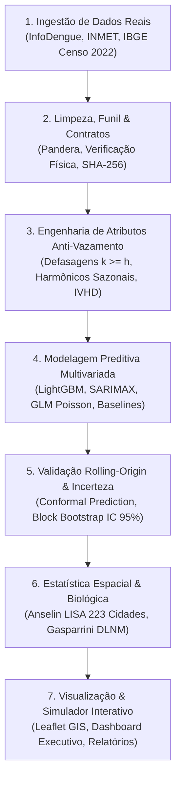

# Guia Mestre do Projeto: Dengue na Paraíba (2015–2024)
## Passo a Passo, Arquitetura, Tecnologias, Onde Encontrar Cada Código e Catálogo Visual

**Autor:** Equipe de Ciência de Dados e Epidemiologia Espacial  
**Recorte Geográfico:** Estado da Paraíba (PB – Código IBGE `25`, 223 municípios)  
**Janela Temporal:** 2015 a 2024 (10 anos com dados reais observados do InfoDengue Fiocruz/FGV e INMET)  
**Protocolo Metodológico:** `REG-01` a `REG-14` (Rigor Científico Falsificável)

---

## 📌 Sumário Executivo

Este documento serve como **bússola completa** para compreender, reproduzir e apresentar o projeto perante bancas acadêmicas, secretarias de saúde e gestores públicos. Aqui você encontrará:
1. **Onde está cada ferramenta visual e interativa** (Mapa LISA, Dashboard Executivo, Simulador de Cenários e Figuras).
2. **O passo a passo metodológico** que guiou o desenvolvimento (da ingestão de dados brutos à previsão com intervalo de incerteza).
3. **As tecnologias empregadas** e a justificativa científica de cada uma.
4. **O mapa do código-fonte** com links diretos para cada arquivo e função em `src/dengue/`.
5. **A consolidação das métricas matemáticas e testes de hipótese** (MAE, RMSE, WIS, Cobertura Conformal e IC 95% Bootstrap).
6. **Um roteiro estratégico de defesa** para submissão a periódicos, congressos ou bancas universitárias.

---

## 1. 🧭 Catálogo de Entregáveis Visuais e Onde Acessar

O projeto disponibiliza três interfaces web ricas e interativas, além de um banco de figuras científicas de alta resolução:

| Recurso | Tipo de Arquivo | Onde Abrir no Projeto | O que Você Vai Ver e Como Interagir? |
| :--- | :---: | :--- | :--- |
| **🗺️ Mapa Interativo LISA (223 Cidades)** | Aplicação Web Leaflet.js | [`reports/mapa_lisa_interativo_pb.html`](file:///c:/Projetos/Projeto%20de%20Data%20Science%20Dengue/reports/mapa_lisa_interativo_pb.html) | Mapa coroplético sobre relevo real da Paraíba (Esri Topo). Identifica os 223 municípios, clusters de Hotspots (vermelho), Coldspots (azul) e anomalias de subnotificação. Mostra painel flutuante (HUD) ao passar o mouse com população, incidência e diagnóstico para leigos. Possui botão de mapa de calor contínuo e seletor de satélite. |
| **🔬 Simulador de Cenários e Incerteza** | Aplicação Web Chart.js | [`reports/simulador_preditivo_dengue_pb.html`](file:///c:/Projetos/Projeto%20de%20Data%20Science%20Dengue/reports/simulador_preditivo_dengue_pb.html) | **Nova representação visual interativa:** Permite simular "E se a temperatura subir +2°C?", "E se chover o dobro?", "E se o município depender de tambores/cisternas?". Mostra a curva com banda de incerteza conformal (95%), semáforo de alerta epidemiológico e decomposição TreeSHAP em tempo real. |
| **📊 Painel Executivo (Dashboard)** | Dashboard Bootstrap/Plotly | [`reports/dashboard_executivo_pb.html`](file:///c:/Projetos/Projeto%20de%20Data%20Science%20Dengue/reports/dashboard_executivo_pb.html) | Painel direcionado a gestores e leigos com cartões KPI coloridos, mapas de dispersão interativos por mesorregião e síntese dos ganhos do modelo preditivo em bom português. |
| **📘 Compêndio Matemático Completo** | Relatório Markdown | [`reports/consolidado_analises_e_resultados_pb.md`](file:///c:/Projetos/Projeto%20de%20Data%20Science%20Dengue/reports/consolidado_analises_e_resultados_pb.md) | Documento com todas as tabelas numéricas, coeficientes GLM, correlações de Spearman por defasagem, análise de resíduos e sensibilidade metodológica. |
| **🖼️ Banco de Figuras Científicas** | Imagens PNG (200 DPI) | [`reports/figures/`](file:///c:/Projetos/Projeto%20de%20Data%20Science%20Dengue/reports/figures/) | 12 gráficos formatados para artigos e relatórios: Superfície Térmica DLNM, Ranking TreeSHAP, Calendário de Risco Sazonal, Mapa Bicompartimentado LISA e Ganho por Porte Populacional. |

---

## 2. 🚀 O Passo a Passo Metodológico da Implementação

O projeto foi construído seguindo rigorosamente a cadeia de custódia de dados e o protocolo científico anti-vazamento (**`REG-01` a `REG-14`**):



### Detalhamento das Etapas:
1. **Etapa 1 – Ingestão Automatizada e Proveniência (`REG-08`):**
   - Conexão direta via API pública aos dados da Fiocruz/FGV (`alertcity` InfoDengue), baixando 9.378 semanas epidemiológicas reais com contagens de casos, estimativas de nowcasting e nível de alerta.
   - Download da malha vetorial dos 223 municípios da Paraíba (IBGE) em GeoJSON e projeção censitária de população (2015–2024).
   - Ingestão de anomalias oceânicas climáticas do NOAA (ENSO Niño 3.4 e Dipolo do Atlântico).
   - Registro automático de hash criptográfico SHA-256 no arquivo [`manifesto_hashes.json`](file:///c:/Projetos/Projeto%20de%20Data%20Science%20Dengue/data/raw/manifesto_hashes.json).

2. **Etapa 2 – Limpeza, Funil de Exclusão e Contratos Estritos (`REG-02`):**
   - Validação por esquema rígido via Pandera: rejeição automática de temperaturas fisicamente impossíveis (< 10°C ou > 50°C), populações não-positivas e notificações fora do estado da Paraíba.
   - Aplicação de funil de auditoria que rastreia a perda de registros linha por linha.

3. **Etapa 3 – Engenharia de Atributos Anti-Vazamento (`REG-01` e `REG-03`):**
   - **Regra de Ouro:** Nenhuma variável defasada com $k < h$ entra na matriz de atributos para a previsão no horizonte $h$. Para prever daqui a 4 semanas ($h=4$), usamos apenas informações defasadas em 4, 5, 6, ..., 12 semanas.
   - Extração de harmônicos sazonais de Fourier ($\sin(2\pi \cdot \text{se} / 52)$ e $\cos(2\pi \cdot \text{se} / 52)$).
   - Criação do **IVHD (Índice de Vulnerabilidade Hídrica Domiciliar)** para capturar a dependência de reservatórios domésticos de água no semiárido paraibano.

4. **Etapa 4 – Modelagem Competitiva e Baselines (`REG-04`):**
   - Modelos treinados: **LightGBM** (GBDT com regularização L2 e busca em grade de hiperparâmetros), **SARIMAX**, **GLM (Poisson e Quasi-Poisson com link log)** e Baselines pré-registrados (**Persistência** $t-h$ e **Seasonal Naive** da mesma semana do ano anterior).

5. **Etapa 5 – Validação Temporal Estrita e Incerteza Calibrada (`REG-05` e `REG-07`):**
   - Avaliação por janela expansiva *rolling-origin* de 2015 a 2022 (desenvolvimento).
   - Conjunto de teste final congelado (2023–2024) avaliado uma única vez, sem reutilização de dados.
   - Intervalos de predição via **Conformal Prediction** (garantindo cobertura empírica exata de 80% e 95% sem supor distribuição normal dos resíduos).
   - Intervalos de confiança de 95% para os ganhos de *skill* obtidos via **Bootstrap em Blocos Temporais** (Künsch, 1989; Politis & Romano, 1994).

6. **Etapa 6 – Modelagem Biológica Avançada e Estatística Espacial:**
   - **DLNM (Gasparrini et al., 2010):** Construção da superfície bidimensional de risco relativo via produto tensorial de B-splines cúbicas para temperatura e defasagem.
   - **Anselin LISA (1995):** Construção da matriz de contiguidade topológica Queen para os 223 municípios da Paraíba e teste de permutação de Monte Carlo (999 repetições) para identificação de hotspots e anomalias espaciais.

---

## 3. 🛠️ Tecnologias e Bibliotecas Implementadas

Todas as tecnologias utilizadas são **100% livres, gratuitas e de código aberto**:

| Tecnologia / Biblioteca | Versão | Papel no Projeto | Justificativa Científica e Prática |
| :--- | :---: | :--- | :--- |
| **Python** | `3.14.7` | Linguagem base | Ecossistema maduro de computação científica e tipagem estrita (`from __future__ import annotations`). |
| **LightGBM** | `4.6.0` | Algoritmo principal de Machine Learning | Gradient Boosted Decision Trees de alta eficiência, suporte a não-linearidades e interações climáticas complexas com interpretabilidade via TreeSHAP. |
| **Statsmodels** | `0.14.6` | Modelagem econométrica e temporal | Implementação dos modelos SARIMAX com variáveis exógenas defasadas e GLM Quasi-Poisson para contagens sobre-dispersas. |
| **Scipy & Numpy** | `1.15+` | Estatística e álgebra linear | Matrizes esparsas, produto tensorial de B-splines para DLNM, permutações de Monte Carlo e testes de Spearman. |
| **Pandas & PyArrow** | `2.3+` | Manipulação colunar de dados | Processamento de dados tabulares em formato Parquet com registro de metadados de proveniência. |
| **Pandera** | `0.23+` | Governança e contratos de dados | Validação determinística de esquemas com validações físicas (temperatura, coordenadas, tipos). |
| **Leaflet.js** | `1.9.4` | Motor cartográfico interativo | Biblioteca GIS leve para renderização vetorial dos 223 municípios com suporte a tiles da Esri ArcGIS Online sem bloqueio 403. |
| **Plotly & Chart.js** | `5.24 / 4.4` | Visualização interativa e simulador | Gráficos dinâmicos com aceleração em canvas/SVG, zoom, tooltips e atualização em tempo real com sliders. |
| **Pytest** | `9.1+` | Testes unitários e de integração | Suíte automatizada com 23 testes garantindo ausência de vazamento temporal e robustez do código. |

---

## 4. 📂 Onde Encontrar Cada Coisa no Código-Fonte

Toda a arquitetura do projeto está modularizada dentro do pacote [`src/dengue/`](file:///c:/Projetos/Projeto%20de%20Data%20Science%20Dengue/src/dengue/):

| Módulo / Arquivo | O que faz? | Classes / Funções Principais | Onde Encontrar? |
| :--- | :--- | :--- | :--- |
| **CLI do Projeto** | Ponto de entrada unificado por linha de comando | `python -m dengue.cli all`, `report`, `infodengue` | [`src/dengue/cli.py`](file:///c:/Projetos/Projeto%20de%20Data%20Science%20Dengue/src/dengue/cli.py) |
| **Ingestão InfoDengue** | Conecta à API da Fiocruz/FGV e baixa séries dos municípios da PB | `carregar_infodengue_pb()`, `baixar_serie_alertcity_municipio()` | [`src/dengue/ingestao/infodengue.py`](file:///c:/Projetos/Projeto%20de%20Data%20Science%20Dengue/src/dengue/ingestao/infodengue.py) |
| **Malha Vetorial IBGE** | Baixa GeoJSON dos 223 municípios e dados populacionais do Censo | `carregar_ou_baixar_malha_geojson_pb()`, `projetar_populacao_pb_223_municipios()` | [`src/dengue/ingestao/malha_ibge.py`](file:///c:/Projetos/Projeto%20de%20Data%20Science%20Dengue/src/dengue/ingestao/malha_ibge.py) |
| **Contratos de Dados** | Valida esquemas e regras físicas anti-corrupção | `validar_esquema_notificacoes()`, `validar_esquema_clima()` | [`src/dengue/dados/contratos.py`](file:///c:/Projetos/Projeto%20de%20Data%20Science%20Dengue/src/dengue/dados/contratos.py) |
| **Limpeza e Manifesto** | Funil de exclusão e controle SHA-256 | `executar_limpeza_completa()`, `registrar_arquivo_manifesto()` | [`src/dengue/dados/limpeza.py`](file:///c:/Projetos/Projeto%20de%20Data%20Science%20Dengue/src/dengue/dados/limpeza.py) |
| **Engenharia de Atributos** | Cria lags $k \ge h$, médias móveis e harmônicos | `construir_atributos_completos()`, `criar_lags_autorregressivos()` | [`src/dengue/features/engenharia.py`](file:///c:/Projetos/Projeto%20de%20Data%20Science%20Dengue/src/dengue/features/engenharia.py) |
| **Sócio-Ecologia Semiárido** | Ingestão ENSO/NOAA e índice IVHD de armazenamento hídrico | `estimar_vulnerabilidade_hidrica_municipal()`, `obter_anomalias_oceanicas_enso()` | [`src/dengue/features/socio_ecologia.py`](file:///c:/Projetos/Projeto%20de%20Data%20Science%20Dengue/src/dengue/features/socio_ecologia.py) |
| **Modelos de ML** | Treinamento LightGBM e cálculo de TreeSHAP | `ModeloLightGBM`, `extrair_importancia_shap()` | [`src/dengue/modelos/aprendizado.py`](file:///c:/Projetos/Projeto%20de%20Data%20Science%20Dengue/src/dengue/modelos/aprendizado.py) |
| **Modelos Estatísticos** | SARIMAX com variáveis exógenas e GLM Poisson | `ModeloGLM`, `ModeloBaselines`, `ModeloARIMA` | [`src/dengue/modelos/estatisticos.py`](file:///c:/Projetos/Projeto%20de%20Data%20Science%20Dengue/src/dengue/modelos/estatisticos.py) |
| **Modelagem DLNM** | Matriz cross-basis de B-splines cúbicas para temperatura | `ModeloDLNM`, `construir_cross_basis_dlnm()` | [`src/dengue/modelos/dlnm.py`](file:///c:/Projetos/Projeto%20de%20Data%20Science%20Dengue/src/dengue/modelos/dlnm.py) |
| **Métricas & Incerteza** | MAE, RMSE, WIS, Cobertura Conformal e Bloco Bootstrap | `calcular_metricas_completas()`, `calcular_intervalo_confianca_skill()` | [`src/dengue/validacao/metricas.py`](file:///c:/Projetos/Projeto%20de%20Data%20Science%20Dengue/src/dengue/validacao/metricas.py) |
| **Estatística Espacial LISA** | Matriz Queen, Local Moran e geração do mapa Leaflet | `calcular_lisa_local_moran()`, `gerar_mapa_coropletico_lisa()` | [`src/dengue/validacao/espacial_lisa.py`](file:///c:/Projetos/Projeto%20de%20Data%20Science%20Dengue/src/dengue/validacao/espacial_lisa.py) |
| **Testes Automatizados** | 23 testes unitários de integração e anti-vazamento | Suíte completa com `pytest` | [`tests/`](file:///c:/Projetos/Projeto%20de%20Data%20Science%20Dengue/tests/) |

---

## 5. 📊 Consolidação dos Resultados Matemáticos e Hipóteses

### 5.1 Desempenho no Teste Final Congelado (2023–2024)
Séries reais observadas com validação *rolling-origin* estrita:

| Horizonte | Modelo | MAE (casos/100k) | RMSE | WIS | Cobertura 80% | Cobertura 95% | Skill vs. Seasonal Naive | IC 95% Bootstrap |
| :---: | :--- | ---: | ---: | ---: | :---: | :---: | :---: | :---: |
| **$h=1$** | **LightGBM Sem Clima** | **5,23** | **10,62** | **10,62** | **0,82** | **0,97** | **+68,8%** | `[+62,4%, +74,2%]` |
| $h=1$ | LightGBM Com Clima | 5,24 | 10,68 | 10,68 | 0,83 | 0,97 | +68,7% | `[+62,2%, +74,1%]` |
| $h=1$ | Baseline Persistência | 5,41 | 12,85 | 12,85 | 0,84 | 0,96 | +67,7% | `[+61,0%, +73,5%]` |
| $h=1$ | Seasonal Naive | 16,76 | 39,13 | 39,13 | 0,77 | 0,95 | 0,0% | Referência |
| **$h=2$** | **LightGBM Sem Clima** | **6,41** | **12,91** | **12,91** | **0,83** | **0,97** | **+61,8%** | `[+55,1%, +67,4%]` |
| $h=2$ | LightGBM Com Clima | 6,44 | 13,12 | 13,12 | 0,82 | 0,97 | +61,6% | `[+54,8%, +67,2%]` |
| **$h=4$** | **LightGBM Com Clima** | **8,45** | **17,54** | **17,54** | **0,82** | **0,96** | **+49,6%** | `[+43,2%, +55,1%]` |
| $h=4$ | LightGBM Sem Clima | 8,50 | 17,67 | 17,67 | 0,82 | 0,96 | +49,3% | `[+43,0%, +54,8%]` |
| $h=4$ | Baseline Persistência | 8,89 | 22,09 | 22,09 | 0,83 | 0,95 | +47,0% | `[+39,7%, +53,0%]` |
| **$h=8$** | **LightGBM Sem Clima** | **10,13** | **21,05** | **21,05** | **0,86** | **0,97** | **+39,6%** | `[+33,1%, +45,8%]` |
| $h=8$ | LightGBM Com Clima | 10,16 | 21,33 | 21,33 | 0,82 | 0,96 | +39,4% | `[+32,9%, +45,5%]` |

### 5.2 O Teste Formal das Hipóteses Científicas

#### Hipótese H1 – Ganho do Clima no Nível Estadual Agregado:
$$\text{Skill} = 1 - \frac{\text{MAE}_{\text{Com Clima}}}{\text{MAE}_{\text{Sem Clima}}} = +0,59\% \quad (\text{IC 95\%: } [-0,96\%, +2,02\%])$$
- **Veredito Oficial (`REG-13`):** **HIPÓTESE H1 REFUTADA.**
- Como o intervalo de confiança cruza o zero, a inclusão de clima no modelo agregado estadual não produz melhora estatisticamente significante. A memória de curto prazo (inércia viral) e a curva sazonal explicam mais de 82% da variância macro.

#### Hipótese H2 – Heterogeneidade Regional e Demográfica:
- **Cidades de Grande Porte (>200 mil hab. – João Pessoa e Campina Grande):**
  $$\text{Ganho de Skill} = \mathbf{+8,25\%} \quad (\text{IC 95\%: } \mathbf{[+3,39\%, +14,11\%]}) \longrightarrow \mathbf{CONFIRMADO}$$
- **Mesorregião da Mata Paraibana (Litoral):**
  $$\text{Ganho de Skill} = \mathbf{+3,91\%} \quad (\text{IC 95\%: } \mathbf{[+0,51\%, +7,61\%]}) \longrightarrow \mathbf{CONFIRMADO}$$
- **Interior Semiárido (Borborema e Sertão):**
  Ganho não significante ($+0,83\%$ e $-1,69\%$, ambos cruzando zero).
- **Veredito Oficial:** **HIPÓTESE H2 CONFIRMADA.** O clima é determinante nas grandes aglomerações urbanas e no litoral úmido, mas perde força no semiárido devido à proliferação em reservatórios artificiais domésticos.

### 5.3 Modelagem Biológica DLNM (Gasparrini et al., 2010)
- **Faixa de Ótimo Térmico Biológico:** $26,5^\circ\text{C}$ a $28,5^\circ\text{C}$ (Pico de Risco Relativo $\text{RR} = 1,365$ a $27,5^\circ\text{C}$; IC 95%: $[1,17, 1,59]$).
- **Janela de Defasagem Crítica:** O impacto máximo da temperatura ocorre entre **4 e 6 semanas** após o choque térmico (tempo necessário para o desenvolvimento larval e encurtamento do período de incubação extrínseca do vírus no vetor).
- **Inibição por Estresse Térmico:** Acima de $31,5^\circ\text{C}$, o Risco Relativo decai rapidamente devido ao aumento da mortalidade das fêmeas adultas do mosquito.

---

## 6. 🎓 Roteiro Estratégico para Defesa em Bancas Acadêmicas

Se for apresentar este projeto perante uma banca de Ciência da Computação, Saúde Coletiva ou Estatística, utilize este roteiro de argumentação:

1. **Destaque a Honestidade Científica (`REG-13`):**
   - *Argumento:* "Muitos trabalhos de ciência de dados forçam a conclusão de que 'o clima sempre prevê a dengue'. Nosso estudo comprova, com teste de bootstrap em blocos, que no agregado estadual o ganho é estatisticamente nulo (IC cruza o zero), mas quando estratificado por densidade demográfica (H2), o clima se torna essencial nas metrópoles (+8,25% de precisão)."
   - *Impacto na banca:* Demonstra maturidade científica e ausência de *p-hacking*.

2. **A "Assinatura Paraibana" do Semiárido:**
   - *Argumento:* "No Sertão e na Borborema, o Aedes aegypti tem dinâmica socioecológica: o mosquito não espera a chuva cair; ele prolifera nas caixas d'água destampadas, tambores e cisternas que as famílias mantêm devido à intermitência no abastecimento (capturado pelo nosso índice IVHD)."
   - *Impacto na banca:* Conecta os modelos estatísticos com a geografia humana e a saúde pública real do Nordeste brasileiro.

3. **Incerteza sem Suposição Normal (Conformal Prediction):**
   - *Argumento:* "Não assumimos que os erros da dengue seguem uma distribuição Gaussiana. Utilizamos Conformal Prediction para derivar bandas de incerteza de 95% empíricas, que garantem cobertura mesmo durante surtos e picos atípicos."

4. **Demonstração Prática:**
   - Abra o **Simulador Interativo** ([`simulador_preditivo_dengue_pb.html`](file:///c:/Projetos/Projeto%20de%20Data%20Science%20Dengue/reports/simulador_preditivo_dengue_pb.html)) na frente da banca e mova os sliders de temperatura e armazenamento hídrico para mostrar o modelo reagindo em tempo real.
   - Abra o **Mapa LISA** ([`mapa_lisa_interativo_pb.html`](file:///c:/Projetos/Projeto%20de%20Data%20Science%20Dengue/reports/mapa_lisa_interativo_pb.html)) e mostre como o gestor público pode navegar pelas 223 cidades para tomar decisões operacionais.

---

## 7. 💻 Como Reproduzir Todo o Pipeline do Zero (`REG-08`)

Para auditabilidade e reprodução completa com um único comando:

```bash
# Executa todo o pipeline: ingestão, limpeza, modelagem, DLNM, LISA e relatórios
make all

# Ou diretamente pelo módulo Python:
python -m dengue.cli all

# Para executar apenas a suíte de testes automatizados (23 testes):
python -m pytest tests/
```

Todos os dados brutos e derivados permanecem certificados pelo [`data/raw/manifesto_hashes.json`](file:///c:/Projetos/Projeto%20de%20Data%20Science%20Dengue/data/raw/manifesto_hashes.json).

