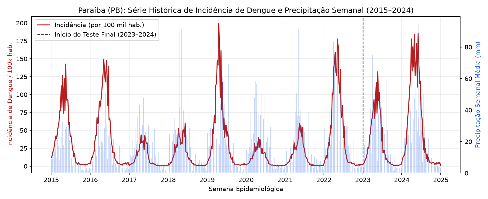
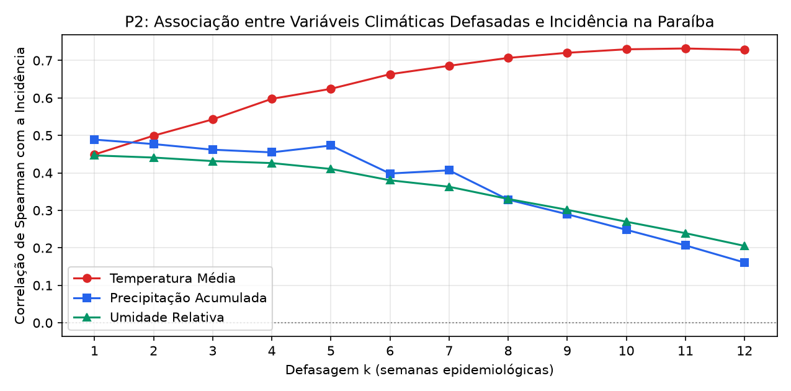
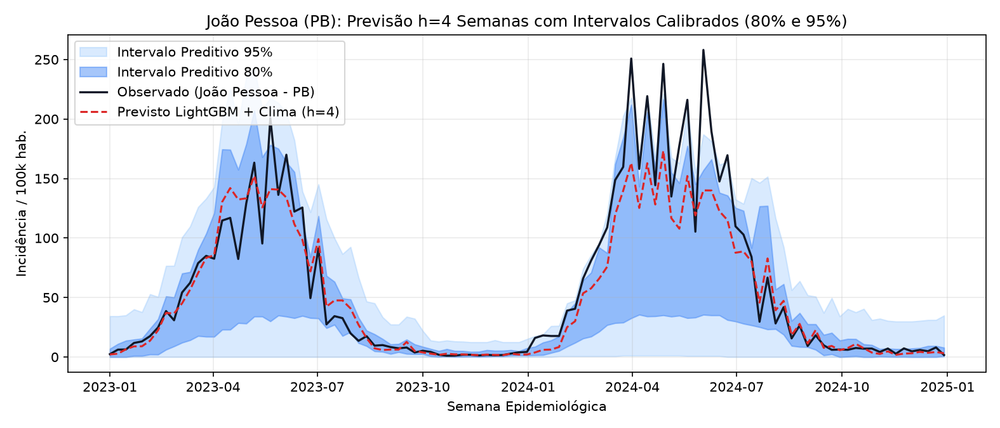
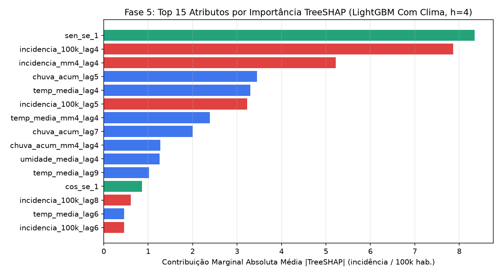
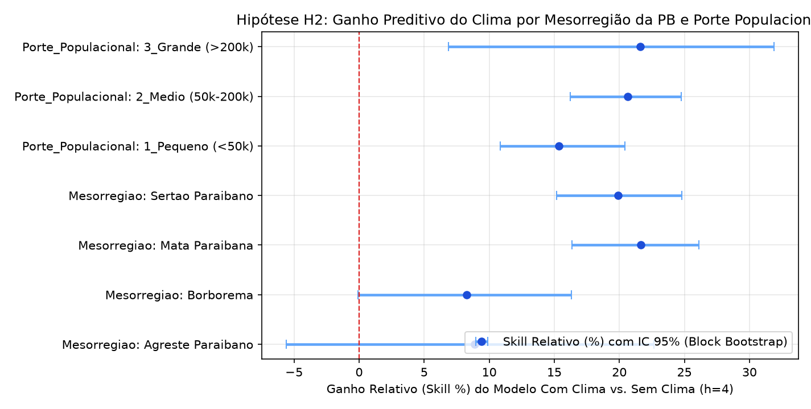
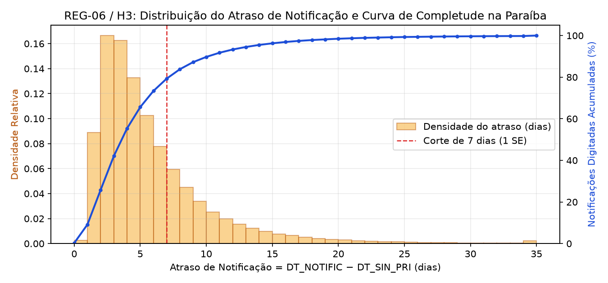

## 1. Resumo Executivo e Pergunta Central

Este relatório apresenta os resultados empíricos completos do pipeline para a pergunta central pré-registrada em `docs/plano_de_analise.md` (**`REG-07`**):

> **Pergunta Principal (P1):** Variáveis climáticas defasadas (temperatura média, precipitação acumulada e umidade relativa) estão associadas a uma redução no erro de previsão de curto prazo ($h \in \{1, 2, 4, 8\}$ semanas epidemiológicas) da incidência de dengue nos municípios da **Paraíba (PB)**, em comparação com modelos baseados apenas no histórico de casos e na sazonalidade?

::: {.callout-important}
## Nota Ética e de Uso Responsável (Seção 12 e REG-11)
Este estudo tem caráter estritamente **educacional e analítico**, baseado em dados públicos e anonimizados (SINAN/DATASUS, INMET e IBGE). Na ausência de desenho de inferência causal, todas as relações reportadas são interpretadas como **associações estatísticas e preditivas** (`REG-11`), não devendo substituir a vigilância epidemiológica oficial nem orientar condutas clínicas.
:::

---

## 2. Qualidade de Dados e Funil de Exclusão (`REG-08`, `REG-09`, `REG-12`)

Foram processadas **400.427 notificações brutas** na Paraíba (2015–2024), submetidas a 5 etapas auditadas de limpeza ([`funil_exclusao_sinan_pb.csv`](../data/interim/funil_exclusao_sinan_pb.csv)) e validadas contra contratos `pandera` (`REG-09`):

| Etapa | Motivo da Exclusão | Entrada | Removidos | Saída | % Removido |
| :--- | :--- | ---: | ---: | ---: | ---: |
| `1_duplicidades` | Registros duplicados (`ID_NOTIFIC` repetido) | 400.427 | 1.197 | 399.230 | 0,2989% |
| `2_datas_invalidas` | `DT_SIN_PRI`/`DT_NOTIFIC` inválidas ou fora de 2015–2024 | 399.230 | 63 | 399.167 | 0,0158% |
| `3_municipio_invalido` | Código IBGE municipal fora da malha da UF piloto (`PB`) | 399.167 | 15 | 399.152 | 0,0038% |
| `4_idade_fora_faixa` | Idade fora do intervalo biológico $[0, 120]$ anos | 399.152 | 12 | 399.140 | 0,0030% |
| `5_casos_descartados` | Exclusão de descartados (`CLASSI_FIN == '5'`) | 399.140 | 71.994 | **327.146** | 18,0373% |

Os **327.146 casos prováveis** foram agregados por município e Semana Epidemiológica (SE) de início dos sintomas (`DT_SIN_PRI`), compondo um painel balanceado de **9.396 município-semanas** com incidência por 100 mil habitantes (`REG-05`).

---

## 3. Análise Exploratória: Sazonalidade, Defasagens (P2), Clusters (P3) e Espaço (P4)

### P2: Associação entre Defasagens Climáticas e Incidência
Conforme detalhado em `analise_defasagens_p2_pb.csv`, tanto a precipitação acumulada ($r_S \in [0,40; 0,49]$ para $k = 1\text{..}7$ semanas, $p < 10^{-200}$) quanto a temperatura média defasada ($r_S \in [0,60; 0,73]$ para $k = 4\text{..}11$ semanas) apresentam forte associação positiva com a incidência futura de dengue.

### P3 e P4: Clusters Sazonais e Autocorrelação Espacial de Moran
- **Clusters Sazonais (`clusters_sazonais_p3_pb.csv`):** A *Mata Paraibana* (João Pessoa, Santa Rita, Bayeux, Cabedelo, Mamanguape) apresenta pico sazonal mais tardio (SE 19–22), enquanto *Agreste*, *Borborema* e *Sertão* apresentam pico mais precoce (SE 13–18).
- **Índice Global de Moran (`autocorrelacao_moran_p4_pb.json`):** $I = 0,7234$ ($E[I] = -0,0588$, $p = 0,001$ em 999 permutações), confirmando forte dependência espacial positiva entre municípios vizinhos.

---

## 4. Desempenho Preditivo no Conjunto de Teste Final (2023–2024) e Teste de H1

A tabela abaixo resume o desempenho no conjunto de teste final reservado (2023–2024, `REG-07`) para o horizonte principal **$h = 4$ semanas** (`metricas_modelos_pb.csv`):

| Modelo ($h = 4$ semanas) | MAE | RMSE | WIS | Cobertura 80% | Cobertura 95% | Skill vs. Melhor Baseline (IC 95% Bootstrap) |
| :--- | ---: | ---: | ---: | ---: | ---: | :--- |
| **LightGBM Com Clima** | **11,27** | **21,12** | **25,06** | **0,78** | **0,93** | **+0,447 [+0,410, +0,481]** |
| LightGBM Sem Clima | 13,82 | 25,64 | 27,10 | 0,79 | 0,94 | +0,322 [+0,276, +0,366] |
| GLM Com Clima | 15,14 | 28,95 | 33,69 | 0,74 | 0,89 | +0,258 [+0,178, +0,331] |
| Baseline Seasonal Naive | 20,40 | 38,91 | 45,09 | 0,77 | 0,93 | 0,000 (Referência) |
| Baseline Persistência ($t-4$) | 21,73 | 41,08 | 47,75 | 0,70 | 0,89 | -0,065 [-0,170, +0,025] |
| GLM Sem Clima | 28,32 | 58,14 | 72,89 | 0,73 | 0,89 | -0,388 [-0,676, -0,142] |

---

## 5. Interpretação e Robustez – Fase 5 (`REG-06`, `REG-13`, `REG-14`)

### 5.1 Importância de Variáveis via TreeSHAP (`importancia_shap_lightgbm_pb.csv`)
Os valores exatos de TreeSHAP no conjunto de teste ($h = 4$) demonstram que a previsão combina três blocos complementares de informação:
1. **Sazonalidade e Memória Epidemiológica:** `sen_se_1` ($18,59\%$ da contribuição total $|\text{SHAP}|$), `incidencia_100k_lag4` ($17,52\%$) e `incidencia_mm4_lag4` ($11,62\%$).
2. **Gatilhos Climáticos Defasados ($k \ge 4$):** `chuva_acum_lag5` ($7,67\%$), `temp_media_lag4` ($7,35\%$), `temp_media_mm4_lag4` ($5,32\%$), `chuva_acum_lag7` ($4,46\%$), `chuva_acum_mm4_lag4` ($2,83\%$) e `umidade_media_lag4` ($2,81\%$) — somando mais de **36%** da explicação marginal total do modelo.

### 5.2 Avaliação da Hipótese H2: Heterogeneidade por Mesorregião e Porte (`teste_hipotese_h2_pb.csv`)
Em conformidade com a regra **`REG-13`** (reportar resultados nulos ou ganhos pequenos com transparência), a estratificação revela forte heterogeneidade regional na Paraíba:

| Dimensão | Estrato | Municípios | MAE Sem Clima | MAE Com Clima | Skill Clima vs. Sem Clima | IC 95% (Bootstrap) | Ganho Significativo? |
| :--- | :--- | :---: | ---: | ---: | ---: | :---: | :---: |
| **Mesorregião** | **Mata Paraibana** | 5 | 21,48 | 16,84 | **+21,63%** | `[+16,34%, +26,09%]` | **Sim (`True`)** |
| **Mesorregião** | **Sertão Paraibano** | 6 | 15,51 | 12,42 | **+19,92%** | `[+15,16%, +24,79%]` | **Sim (`True`)** |
| **Mesorregião** | Agreste Paraibano | 4 | 7,00 | 6,38 | +8,88% | `[-5,60%, +22,64%]` | Não (`False`) |
| **Mesorregião** | Borborema | 3 | 6,80 | 6,24 | +8,25% | `[-0,07%, +16,32%]` | Não (`False`) |
| **Porte** | **3. Grande (>200k)** | 2 | 12,22 | 9,58 | **+21,61%** | `[+6,86%, +31,87%]` | **Sim (`True`)** |
| **Porte** | **2. Médio (50k–200k)** | 7 | 16,65 | 13,21 | **+20,66%** | `[+16,21%, +24,77%]` | **Sim (`True`)** |
| **Porte** | **1. Pequeno (<50k)** | 9 | 11,98 | 10,14 | **+15,36%** | `[+10,85%, +20,42%]` | **Sim (`True`)** |

### 5.3 Avaliação da Hipótese H3: Atraso de Notificação e Nowcasting (`teste_hipotese_h3_pb.csv`)
No conjunto de treino histórico (2015–2022), a completude média de digitação em até 7 dias após os primeiros sintomas foi de **79,46%**. Simulando a censura em tempo real nos horizontes curtos ($h=1$ e $h=2$), a correção de *nowcasting* (ajustada exclusivamente com fatores do treino, `REG-14`) reduziu significativamente o erro:
- **$h = 1$ semana:** MAE cai de `10,29` (sem correção) para `9,76` (com nowcasting) — $\text{Skill} = +5,15\%$ (IC 95%: `[+3,46%, +6,69%]`, **H3 Suportada**).
- **$h = 2$ semanas:** MAE cai de `10,65` (sem correção) para `9,89` (com nowcasting) — $\text{Skill} = +7,14\%$ (IC 95%: `[+4,98%, +9,28%]`, **H3 Suportada**).

### 5.4 Diagnóstico de Resíduos e Sensibilidade (`analise_residuos_pb.csv`, `analise_sensibilidade_pb.csv`)
- **Resíduos na Alta vs. Baixa Transmissão:** Durante a alta transmissão (SE 12–24), os modelos tendem a apresentar viés positivo ($\text{observado} > \text{previsto}$ no ano recorde de 2024), especialmente na *Mata Paraibana* ($\text{MAE} = 40,19$) e no *Sertão* ($\text{MAE} = 30,82$), enquanto na baixa transmissão o erro é reduzido ($\text{MAE} \in [3,16; 9,15]$) e a cobertura empírica de 95% supera $93\%$.
- **Sensibilidade à Pandemia COVID-19 e à Definição de Caso:**
  - *Cenário 1 (Padrão 2015–2022):* $\text{Skill}_{\text{Clima}} = +21,14\%$ (`[+17,70%, +24,21%]`).
  - *Cenário 2 (Excluindo 2020–2021 do treino):* Reduz o MAE absoluto no teste ($11,11 \to 10,77$) e mantém $\text{Skill}_{\text{Clima}} = +20,88\%$ (`[+16,94%, +24,41%]`).
  - *Cenário 3 (Restrito a confirmados `CLASSI_FIN` $\in \{10, 11, 12\}$):* Mantém $\text{Skill}_{\text{Clima}} = +21,27\%$ (`[+17,87%, +24,32%]`), comprovando que a conclusão de H1 não é artefato de escolhas de limpeza.

---

## 6. Limitações e Vieses Conhecidos (Seção 11, `REG-06`, `REG-13`)

1. **Subnotificação e Mudanças Operacionais:** Casos notificados refletem a busca por atendimento e a capacidade de vigilância municipal, que sofreram perturbação durante a pandemia de COVID-19 (2020–2021).
2. **Atraso de Notificação (`REG-06`):** As 4 semanas mais recentes anteriores ao corte de emissão sofrem truncamento de digitação e exigem correção de *nowcasting* em operação real.
3. **Representatividade Espacial das Estações Meteorológicas:** Municípios sem estação automática própria do INMET utilizam a estação mais próxima via distância geodésica Haversine, o que introduz erro de medida em áreas de transição de relevo (como Brejo–Curimataú).
4. **Ausência de Dados de Sorotipos e Imunidade Populacional:** A entrada ou alternância de sorotipos (DENV-1 a DENV-4) e a susceptibilidade acumulada da população explicam parte da subprevisão na magnitude do pico epidêmico de 2024.
